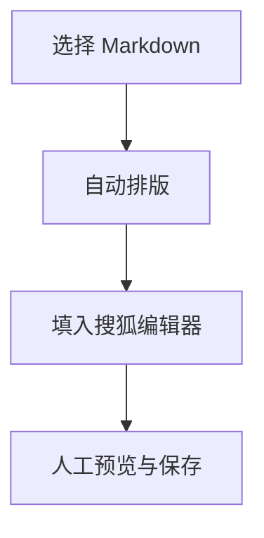

# 搜狐号一键排版验收稿

这是一段用于验证正文样式的普通文本，包含**粗体**和[链接](https://www.sohu.com/)。

## 列表

- 第一项
- 第二项

## 普通图片


## 表格

| 检查项 | 期望结果 |
| --- | --- |
| 标题 | 一级标题填入搜狐标题框 |
| 表格 | 边框和内容完整 |
| Mermaid | 显示为 PNG 图片 |

## 代码块

```js
console.log('搜狐号 Markdown 一键排版')
```

## Mermaid



> 这是一段引用文字。
